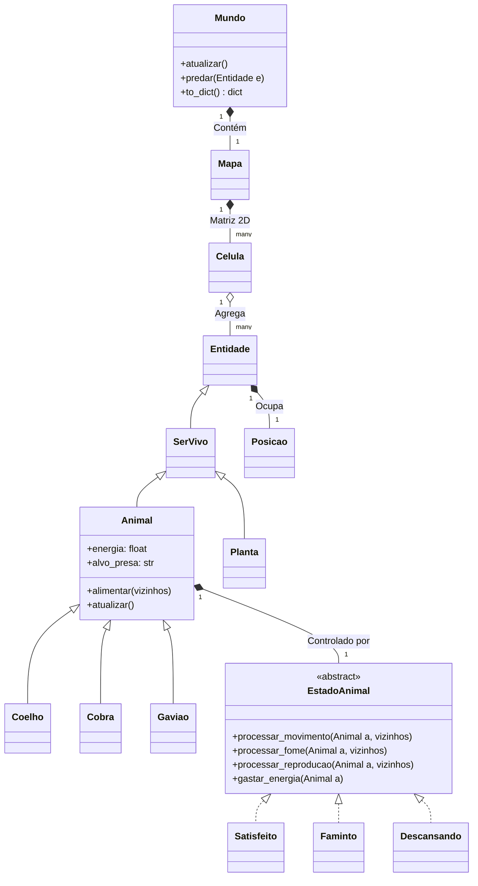

# Arquitetura do Sistema - Projeto Terra

Este documento detalha a arquitetura de software atualizada do **Projeto Terra**, mapeando a estrutura de classes, os padrões de projeto aplicados e o fluxo de dados entre o motor de simulação (Python) e a interface gráfica (React).

## 1. Visão Geral da Arquitetura

O sistema é dividido em três camadas principais:

1. **Engine (Motor da Simulação):** Escrito em Python puro, focado em alta performance e regras determinísticas. Utiliza Orientação a Objetos avançada para simular biologia, física e comportamento emergente.
2. **API (FastAPI):** Camada de comunicação RESTful que expõe o estado da *Engine* para o mundo externo, lidando com a serialização e roteamento.
3. **Front-end (React + Bootstrap):** Interface interativa que consome o estado gerado pela API para renderizar o grid espacial e controlar o fluxo do tempo.

---

## 2. Hierarquia de Entidades (Biologia e O.O.)

A árvore biológica do projeto garante que atributos comuns sejam herdados, eliminando repetição de código (DRY) e garantindo baixo custo de memória através do uso de `__slots__`.

* **`Entidade` (Classe Base)**
  * **Propósito:** Representa qualquer objeto que ocupe espaço no mapa.
  * **Atributos (`__slots__`):** `posicao`
  * **Métodos:** Delega a conversão básica para `to_dict()`.

* **`SerVivo` (Herda de `Entidade`)**
  * **Propósito:** Adiciona o conceito de ciclo de vida e tempo estrutural.
  * **Atributos (`__slots__`):** `vivo` (boolean), `horas` (idade).
  * **Métodos:** Controle de envelhecimento e método de serialização dinâmica (`__class__.__name__`).

* **`Animal` (Herda de `SerVivo`)**
  * **Propósito:** A base comum para qualquer agente que se move, consome energia e possui inteligência.
  * **Atributos (`__slots__`):** `energia`, `consumo_energia`, `consumo_reproducao`, `genero`, `estado`, `chance_predacao`, `alvo_presa`.
  * **Métodos:** `atualizar()`, `alimentar(vizinhos)`, genérica de predação (cálculo de nutrição híbrida = valor base + % gordura).

* **Classes Concretas (Especializações):**
  * **`Coelho`, `Cobra`, `Gaviao`:** Injetam as configurações biológicas do ecossistema e sobrescrevem regras (como a herbivoria de 100% de sucesso no Coelho).
  * **`Planta` (Herda de `SerVivo`):** Vegetação autônoma que possui atributo de `tamanho`.

---

## 3. Comportamento Autônomo (Padrão State)

A tomada de decisão dos animais foi isolada utilizando o **Design Pattern State** (arquivo `estados.py`). Isso remove "Ifs" gigantescos da classe `Animal` e delega a cognição para o estado atual.

* **Interface/Contrato:** `EstadoAnimal` (Classe Abstrata definindo `processar_fome`, `processar_movimento`, `processar_reproducao`, `gastar_energia`).
* **Estados Concretos:**
  1. **`Satisfeito`:** Explora aleatoriamente, busca reprodução.
  2. **`Faminto`:** Cancela outras ações; foca em caçar ativamente (usando o radar de vizinhos).
  3. **`Descansando`:** Trava a posição e reduz o consumo de energia (`REDUCAO_ENERGIA_ESTADO_DESCANSO`) para sobrevivência.

---

## 4. O Espaço e o Tempo (Motor e Grid)

A física e a passagem de tempo são controladas pela tríade geográfica da simulação:

* **`Posicao`:** Utilitário matemático para coordenadas `x` e `y`.
* **`Celula`:** Contêiner geográfico. Guarda o `tipo` de terreno ("terra", "agua") e a lista de instâncias de `Entidade` sobrepostas ali. Bloqueia a entrada de animais na água.
* **`Mapa`:** Matriz bidimensional (2D) de `Celula`. Responsável por instanciar a grade e validar indexações (bordas).
* **`Mundo` (A Engine):** 
  * Possui composição com o `Mapa` e guarda a lista global `entidades_mundo`.
  * **`atualizar()`:** O *Game Loop*. Ocorre 1x a cada Tick (3 horas no mundo biológico). Itera a lista, chama os estados, resolve interações espaciais, e aciona o "Garbage Collector" interno (`remover_mortos()`).

---

## 5. Fluxo de Dados em Cascata (Serialização)

Para enviar os dados ao React, o sistema utiliza uma serialização delegada (em cascata), isolando responsabilidades:

1. A API pede os dados ao `Mundo`.
2. O `Mundo.to_dict()` chama o `to_dict()` do `Mapa`.
3. O `Mapa.to_dict()` itera o grid 2D e chama o `to_dict()` de cada `Celula`.
4. A `Celula.to_dict()` extrai o terreno e aciona o `to_dict()` de cada entidade contida nela, empacotando tudo em um dicionário.
5. O FastAPI converte esse super dicionário em JSON e entrega na rota GET `/estado`.

---

## 6. Diagrama UML de Classes

